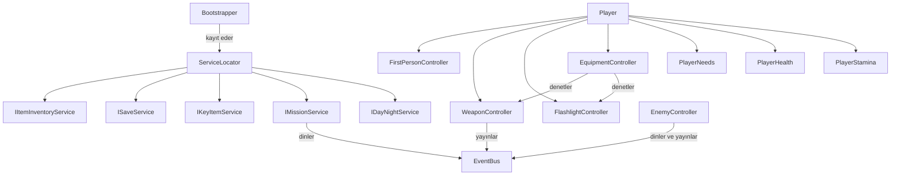
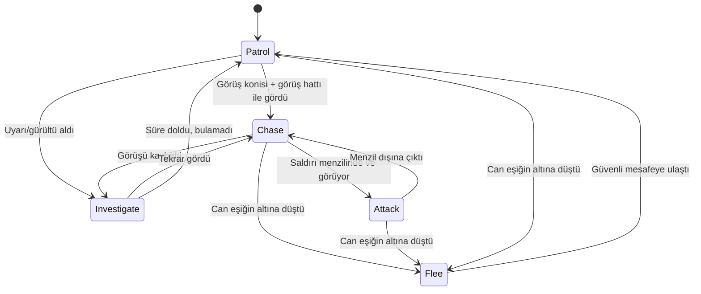
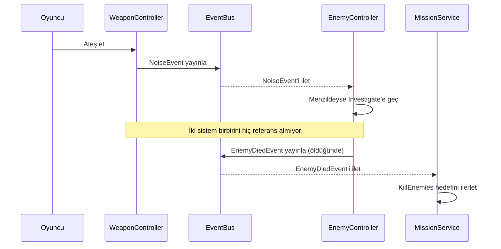

# Bozulma

Birinci şahıs (FPS) hayatta kalma oyunu — Unity 6 / URP ile geliştirilmiştir.

> Terkedilmiş bir yerleşimde, gece çöktükçe daha da tehlikeleşen bir dünyada hayatta kalmaya çalışıyorsun. Kaynak topla, silahını parça parça geliştir, fenerini idareli kullan — çünkü karanlıkta yalnız değilsin.

## İçindekiler

- [Genel Bakış](#genel-bakış)
- [Öne Çıkan Özellikler](#öne-çıkan-özellikler)
- [Mimari ve Teknik Detaylar](#mimari-ve-teknik-detaylar)
- [Çözülen Teknik Zorluklar](#çözülen-teknik-zorluklar)
- [Kullanılan Teknolojiler](#kullanılan-teknolojiler)
- [Kurulum](#kurulum)
- [Kontroller](#kontroller)
- [Krediler / Kullanılan Varlıklar](#krediler--kullanılan-varlıklar)
- [Yol Haritası](#yol-haritası)

---

## Genel Bakış

**Bozulma**, mobil bir fikir olarak başlayıp PC'ye taşınmış, solo geliştirilen bir FPS hayatta kalma oyunu prototipidir. Proje, tek bir amaç etrafında kuruldu: **CV/portfolyo düzeyinde, gerçek mühendislik pratikleri sergileyen bir sistem koleksiyonu** oluşturmak — kod tabanı, endüstri standardı tasarım kalıplarını (Event-Driven Architecture, Service Locator, State Machine, Strategy Pattern, veri-odaklı tasarım) bir araya getirerek birbirine bağlı çalışan bir dizi oyun sistemi sunuyor.

Oyuncu, güvenli bir üsten çıkıp kaynak toplar, düşmanlarla karşılaşır, envanterini yönetir, silahını elindeki parçalarla özelleştirir ve günü/geceyi atlatmaya çalışır — tüm bunlar birbirine bağlı, tek bir görev döngüsü etrafında.

## Öne Çıkan Özellikler

### Silah Sistemi

- Veri-odaklı silah montaj sistemi (`WeaponBaseData` + değiştirilebilir `WeaponPartData` parçaları: Namlu / Şarjör / Dipçik / Nişangah)
- "Bozulmuş" parçalar arıza riski taşır — parça kalitesi doğrudan güvenilirliği etkiler
- Tükenebilir mermi sistemi, gerçek doldurma mekaniği
- Prosedürel geri tepme (recoil), yürüme/koşma sallanması (weapon bob), doldurma animasyonu — hiçbiri önceden hazırlanmış (baked) animasyon gerektirmiyor, tamamen kod tarafında üretiliyor
- Namlu alevi, fizik motorlu şarjör düşürme, tam ses entegrasyonu
- Mimari, yeni silah eklemeyi kod değiştirmeden mümkün kılacak şekilde tasarlandı (yeni `WeaponBaseData` + model prefabı yeterli)

### Düşman Yapay Zekası

- State Machine tabanlı davranış (Devriye / Kovalama / Saldırı / Araştırma / Kaçış)
- **Gerçek algılama:** sadece mesafe değil, görüş konisi (FOV) + `Physics.Linecast` ile gerçek görüş hattı kontrolü
- **İşitsel algılama:** silah sesi gibi olaylar, menzildeki düşmanları görmeden de uyarabiliyor
- **Grup koordinasyonu:** bir düşman oyuncuyu görünce, `EventBus` üzerinden yakındaki diğerlerini haberdar ediyor
- Düşük canda kaçma davranışı, gecelere göre artan zorluk çarpanı
- Düşman, oyuncunun **anlık konumunu bilmiyor** — sadece son gördüğü/duyduğu yeri araştırıyor (omniscient olmayan, algı tabanlı bir yapı)

### Hayatta Kalma Mekanikleri

- Açlık / susuzluk / dayanıklılık (stamina) sistemleri, gerçek zamanlı tükenme
- Fener + pil sistemi — pil durumu bir arayüz çubuğuyla değil, **ışığın kendi davranışıyla** (sönükleşme, titreme) hissettiriliyor
- Silah ile fener arasında geçiş sistemi — ikisi aynı anda elde tutulamıyor (bilinçli bir tasarım kısıtı, gerçek bir taktik gerilim yaratıyor)
- Gün/gece döngüsü, özel bir Shader Graph gökyüzü geçiş shader'ıyla desteklenmiş

### Envanter ve Görev Sistemleri

- Genel, slot tabanlı envanter mimarisi — tüm eşya türleri (silah parçası, kaynak, tüketilebilir, pil) aynı temel sınıftan (`ItemData`) türer
- Ağırlıklı rastgelelik tabanlı loot sistemi (`LootTableData`) — konteynerlere elle eşya yerleştirmek yerine veri-odaklı, tekrar kullanılabilir tablolar
- Sıralı hedeflerden oluşan görev sistemi, mevcut sistemlere (envanter, düşman ölümü, tetikleyici alanlar) `EventBus` üzerinden bağlanıyor

### Diğer

- JSON tabanlı kayıt/yükleme sistemi
- Ana menü (Yeni Oyun / Devam Et / Çıkış), sahne geçişleri arasında güvenli servis başlatma sırası
- Havuzlama (object pooling) ile düşman yönetimi

## Mimari ve Teknik Detaylar

Proje boyunca tutarlı şekilde uygulanan tasarım kalıpları:

| Kalıp                                       | Kullanım Alanı                                                                                                                            |
| ------------------------------------------- | ----------------------------------------------------------------------------------------------------------------------------------------- |
| **Event Bus** (statik, tip güvenli pub/sub) | Sistemler arası, birbirinden habersiz iletişim (ör. bir düşman öldüğünde görev sistemi haberdar oluyor, ama ikisi birbirini hiç bilmiyor) |
| **Service Locator** + `IGameService`        | Envanter, kayıt, görev, anahtar eşya gibi servislerin merkezi yönetimi                                                                    |
| **State Pattern**                           | Düşman AI davranışları, gün/gece döngüsü fazları                                                                                          |
| **Strategy Pattern**                        | Ateş modları (tek atım / otomatik)                                                                                                        |
| **Dependency Inversion**                    | Girdi sistemi (`IInputProvider` soyutlaması)                                                                                              |
| **Veri-Odaklı Tasarım** (ScriptableObject)  | Silah parçaları, kaynaklar, tüketilebilirler, görevler, loot tabloları — hepsi kod değişmeden Inspector'dan tasarlanabilir                |
| **Object Pooling**                          | Düşman spawn sistemi                                                                                                                      |

### Sistem Mimarisi

### Düşman AI Karar Akışı

### Event-Driven Mimari Örneği

Aşağıdaki akış, `WeaponController` ile `EnemyController`'ın **birbirini hiç tanımadığını**, tamamen `EventBus` üzerinden, decoupled şekilde iletişim kurduğunu gösteriyor:

## Kullanılan Teknolojiler

- **Motor:** Unity 6 LTS (6000.3.22f1)
- **Render Pipeline:** Universal Render Pipeline (URP)
- **Dil:** C#
- **Versiyon Kontrolü:** Git / GitHub

## Kurulum

1. [Unity Hub](https://unity.com/download) üzerinden Unity 6000.3.22f1 (ya da uyumlu bir 6 LTS sürümü) kurulu olmalı
2. Bu repoyu klonlayın
3. Unity Hub'dan "Add project from disk" ile proje klasörünü açın
4. `Assets/_Project/Scenes/MainMenu.unity` sahnesini açıp Play'e basın

## Kontroller

| Tuş                  | Aksiyon                               |
| -------------------- | ------------------------------------- |
| `W A S D`            | Hareket                               |
| `Shift` (basılı tut) | Koşma                                 |
| `Space`              | Zıplama                               |
| `Sol Fare`           | Ateş etme                             |
| `R`                  | Doldurma                              |
| `1` / `2`            | Silah / Fener arasında geçiş          |
| `L`                  | Feneri aç/kapat                       |
| `E`                  | Eşya toplama                          |
| `F`                  | Etkileşim (workbench, kamp ateşi vb.) |
| `I`                  | Envanteri aç/kapat                    |
| `Esc`                | Duraklat                              |

---

_Bu proje, bir portfolyo/CV çalışması olarak geliştirilmektedir._
